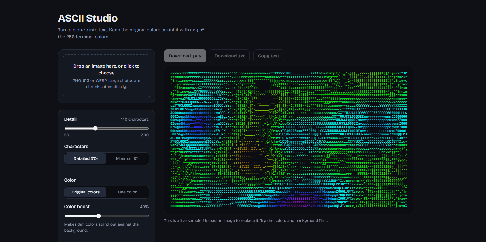
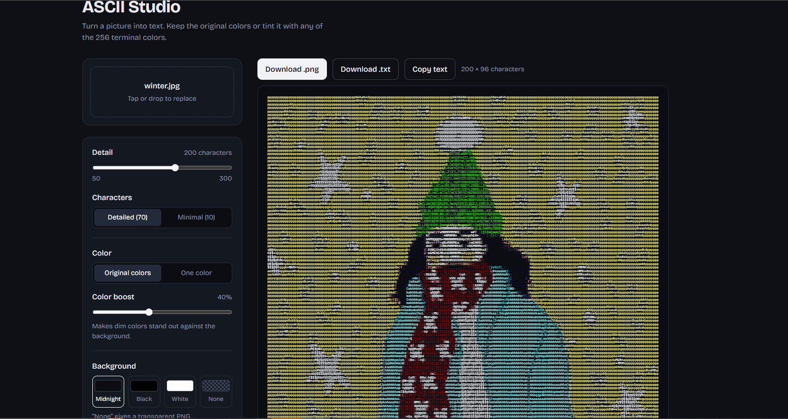
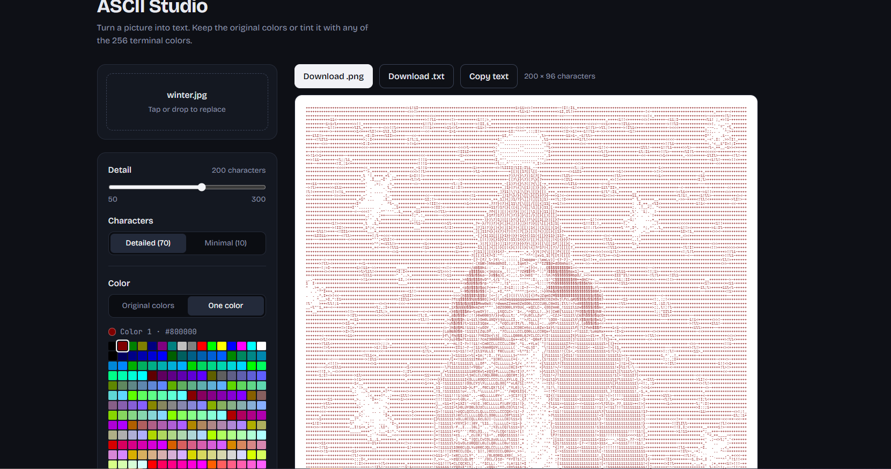

# ASCII Studio — Image to ASCII Art Generator

A web-based application that transforms images into ASCII art. Upload an image, customize the output, experiment with colors and backgrounds, and download your generated artwork.

**Live Demo:** https://ascii-image-generator-sooty.vercel.app/

## Screenshots

### Application Interface


### ASCII Art Generation


### Customized Output


## Features

- Convert images into ASCII art.
- Support for PNG, JPG, JPEG, and WEBP formats.
- Adjustable ASCII width and character density.
- Customizable foreground and background colors.
- Multiple background options.
- Download generated artwork as PNG or TXT.
- Copy ASCII art to clipboard.
- Responsive user interface.

## Tech Stack

- **Backend:** Python, Flask
- **Image Processing:** Pillow (PIL)
- **Frontend:** HTML5, Tailwind CSS, JavaScript
- **Deployment:** Vercel

## Run Locally

### 1. Clone the repository

```bash
git clone https://github.com/farabi092/Ascii-Image-Generator.git
cd Ascii-Image-Generator
```

### 2. Create a virtual environment

```bash
python -m venv venv
```

### 3. Activate the environment

**Windows:**
```bash
venv\Scripts\activate
```

**macOS / Linux:**
```bash
source venv/bin/activate
```

### 4. Install dependencies

```bash
pip install -r requirements.txt
```

### 5. Run the application

```bash
python app.py
```

Open http://127.0.0.1:5000 in your browser.

## Deployment

The application is deployed on [Vercel](https://vercel.com/).

To deploy your own instance:

1. Import the GitHub repository at [vercel.com/new](https://vercel.com/new).
2. Keep the root directory as `./`.
3. Allow Vercel to detect the Flask application.
4. Click **Deploy**.

Alternatively, use the Vercel CLI:

```bash
npm install -g vercel
vercel
vercel --prod
```

## Updating Tailwind CSS

If you modify Tailwind classes in `templates/index.html`, regenerate the compiled CSS:

```bash
npx tailwindcss@3 -i tailwind.input.css -o public/static/css/tailwind.css --content "templates/*.html" --minify
```

## Project Structure

```text
Ascii-Image-Generator/
│
├── app.py
├── requirements.txt
├── tailwind.input.css
│
├── templates/
│   └── index.html
│
├── public/
│   └── static/
│       ├── css/
│       └── js/
│
└── screenshots/
    ├── homepage.png
    ├── ascii-conversion.png
    └── customization.png
```
